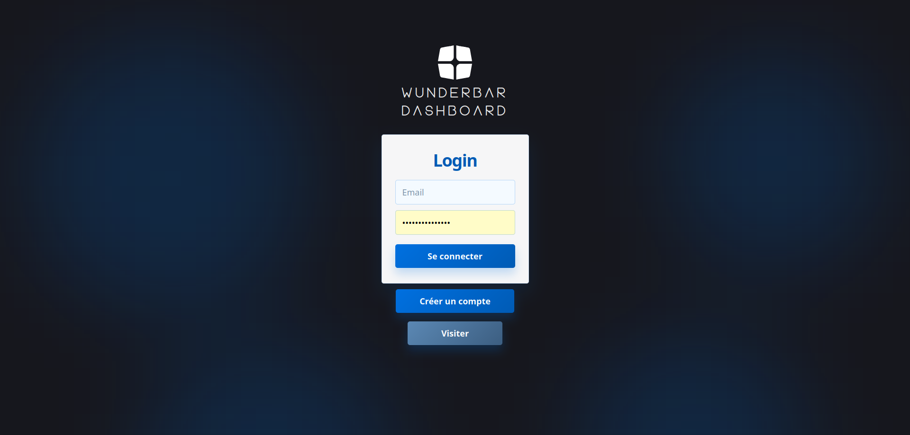
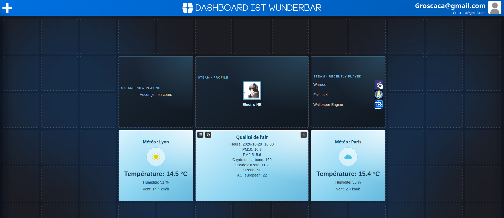
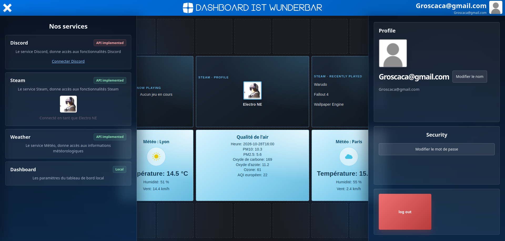

# Wunderbar Dashboard

Un tableau de bord personnalisable : chaque utilisateur crée son compte, connecte ses services (Steam, Discord, météo) et place des widgets sur une grille, comme il veut.



## Aperçu

**Le dashboard avec ses widgets** : profil Steam, jeux en cours et récents, météo de deux villes, qualité de l'air.



**Le menu ＋** : connexion des services, ajout des widgets et profil.



## Fonctionnalités

- **Compte** : inscription, connexion, mode visiteur sans compte, modification du nom et du mot de passe, déconnexion.
- **Grille** : 13 × 6 cases. On y glisse les widgets, on les déplace, on les supprime. La disposition est sauvegardée en base, donc on retrouve son dashboard sur n'importe quel navigateur.
- **Réglages par widget** (⚙) : taille, fréquence de rafraîchissement, ville, taille de l'avatar…
- **Services** : connexion à Discord (OAuth2) et à Steam (OpenID). La météo marche sans compte.

| Service | Widgets |
|---|---|
| Discord | Profil, Bannière |
| Steam | Profil, Jeu en cours, Jeux récents (avec leurs icônes) |
| Météo | Prévisions, Qualité de l'air |

## Technos

| Partie | Outils |
|---|---|
| Frontend | React 19, Vite |
| Backend | Python 3.12, FastAPI, SQLAlchemy, JWT |
| Base de données | PostgreSQL 17 |
| Lancement | Docker Compose |
| API externes | Discord, Steam Web API, Open-Meteo |

## Lancer le projet

1. Crée un fichier `.env` à la racine. La liste des variables est dans le [guide développeur](documentation/dev_guide.md#configuration). Il faut aussi y ajouter `STEAM_API_KEY`.
2. Démarre tout :
   ```bash
   docker compose up --build
   ```
3. La première fois seulement, crée les tables de la base :
   ```bash
   docker exec -i dashboard_postgres sh -c 'psql -U "$POSTGRES_USER" -d "$POSTGRES_DB"' < code/database/dashboard.sql
   ```
4. Ouvre http://localhost:5173.

Le backend répond sur http://localhost:8080. La liste des widgets disponibles est sur http://localhost:8080/about.json.

## Documentation

- [Guide utilisateur](documentation/user_guide.md)
- [Guide développeur](documentation/dev_guide.md)
- [API du backend](documentation/backend_api.md)
- [Base de données](documentation/database.md)
- [Frontend](documentation/frontend.md)
